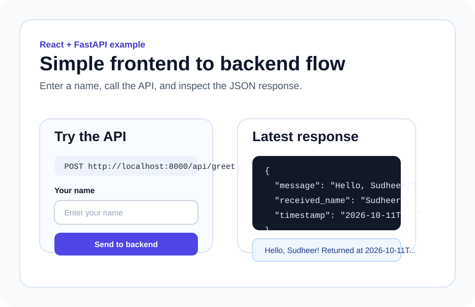
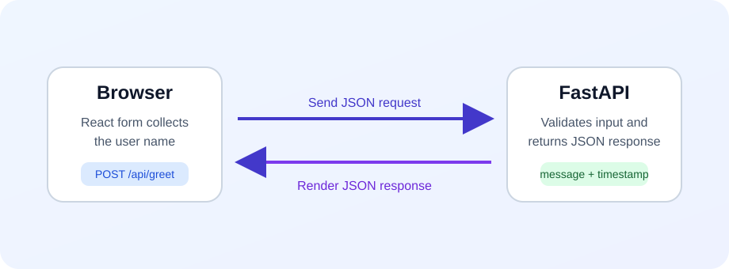

# React frontend repository

This repository contains a very small React app that talks to a FastAPI backend.
It is designed for learning:

- how a form sends a request
- how React handles API responses
- how to point the frontend to a separately deployed backend

## What the app does

1. You type your name in the browser.
2. React sends a `POST` request to the backend.
3. The backend returns JSON.
4. React displays the response on the page.

## Pictures

### Frontend screen



### Request flow



## Project structure

```text
frontend-react/
├── src/
│   ├── services/greetingApi.js
│   ├── App.jsx
│   ├── App.css
│   ├── config.js
│   ├── index.css
│   └── main.jsx
├── docs/
├── .env.example
├── Dockerfile
└── nginx.conf
```

## Local setup

### 1) Install dependencies

```bash
npm install
```

### 2) Configure the backend URL

Copy `.env.example` to `.env` and update it when needed:

```bash
cp .env.example .env
```

Default value:

```env
VITE_API_BASE_URL=http://localhost:8000
```

### 3) Start the app

```bash
npm run dev
```

Open the local URL shown by Vite, usually `http://localhost:5173`.

## How the frontend calls the backend

The API request is in `src/services/greetingApi.js`.

```js
await fetch(`${API_BASE_URL}/api/greet`, {
  method: 'POST',
  headers: { 'Content-Type': 'application/json' },
  body: JSON.stringify({ name }),
})
```

## Build for production

```bash
npm run build
```

The static files are generated in `dist/`.

## Run with nginx locally

Build the container:

```bash
docker build -t basic-react-frontend .
```

Run it:

```bash
docker run --rm -p 8080:8080 basic-react-frontend
```

Open `http://localhost:8080`.

## Deployment idea

- Deploy the backend repo to Cloud Run first.
- Copy the backend Cloud Run URL.
- Set `VITE_API_BASE_URL` to that backend URL during frontend build/deployment.
- Serve the built frontend using nginx.

Example deployed backend URL:

```env
VITE_API_BASE_URL=https://backend-fastapi-xxxxx-uc.a.run.app
```

## Learning notes

- `src/App.jsx` manages form state and response state.
- `src/config.js` keeps environment-specific URLs out of the component.
- `src/services/greetingApi.js` isolates API logic so components stay easier to read.
